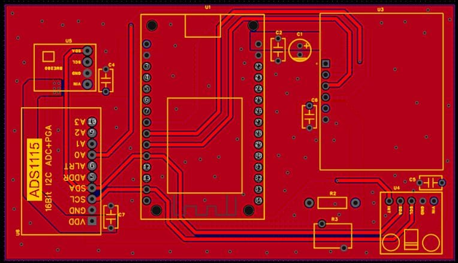
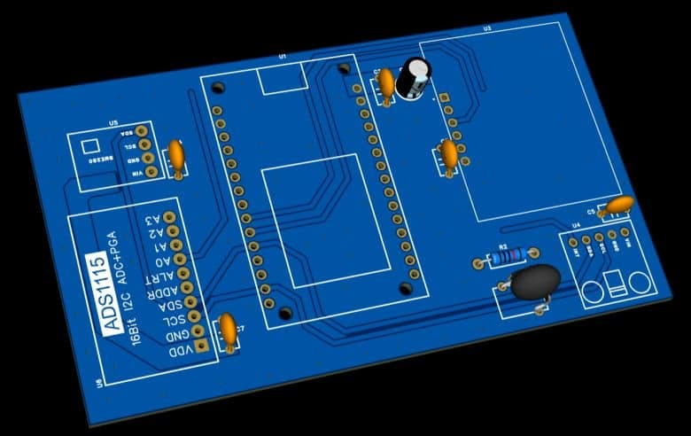

# 🚀 To Space

> Our solution for the **NASA Space Apps Challenge 2026** challenge
> [**Health Monitoring Software**](https://www.spaceappschallenge.org/2026/challenges/health-monitoring-software/).

A wearable **ESP32 prototype** plus an **AI-assisted web dashboard** that tracks an astronaut's vital signs in real time, estimates **bone and muscle loss** during long missions, watches for **psychological stress**, and sends short summaries to the **ground team**.


---

## 🌍 The Problem

Long missions on the ISS (and later the Moon and Mars) put astronauts at risk in two main ways:

1. **Bone and muscle loss.** In microgravity, astronauts lose bone density and muscle mass every month. Daily exercise slows this down, but crews and flight surgeons need to know whether the exercise is actually being done, and how hard.
2. **Psychological and behavioral stress.** Isolation, distance from family and Earth, heavy workload and poor sleep affect mood and performance. Early signs are easy to miss until they become serious.

There's no doctor on board, and contact with Earth is limited. So the crew needs a system that monitors continuously, explains what it sees in simple language, and tells the ground team when something needs attention.

## 💡 Our Solution

### 1. Bone & muscle loss monitor 🦴
- Store the astronaut's **pre-flight baseline**: bone density, muscle mass, mission start date and daily exercise target.
- **Track exercise sessions** live: duration, heart rate, time in the training zone (≥ 50 % of max HR) and lowest SpO₂.
- Calculate **7-day exercise adherence** and an **estimated bone and muscle loss** since launch. The model is a heuristic: about 1.2 %/month bone and 1.5 %/week muscle when there's no exercise, reduced by adherence.
- Recommend a **real medical checkup** when one is due. Real checkup results always override the estimate.

### 2. Psychological & behavioral monitor 🧠
- Build a **personal baseline** for heart rate and **HRV (RMSSD)**, measured from the ECG.
- Calculate a **stress index** by comparing live HR/HRV with that baseline.
- **Voice tone check:** records 8 seconds and compares pitch and energy with the astronaut's own baseline.
- **Daily check-in questionnaire** covering mood, sleep, stress, isolation and workload.
- **AI support assistant** (Arabic or English) that listens, asks gentle questions and suggests simple steps such as breathing, a break or calling family. It never diagnoses or gives medication advice.
- **Ground-team queue:** if concerning signs continue, an alert is saved and sent at the next communication window.

### 3. End-of-day report 📄
Every day, the system creates a report with exercise, vitals, bone/muscle risk and mental state. The AI writes a **short summary for the flight surgeon** (English or Arabic).

### 4. Clinical monitoring
- Live **ECG waveform**, heart rate, **SpO₂**, **body temperature**, and **cabin temperature and humidity**.
- **Clinical Alert Center** with normal/warning/critical status and care suggestions.
- **Data logging** at a chosen interval, with **Excel export**.

> ⚠️ This is a hackathon prototype for research and demonstration. It is **not a medical device** and does not give a diagnosis.

---

## 🧩 System Architecture

```
 ┌──────────────── Wearable prototype ────────────────┐
 │  AD8232 ECG ─┐                                     │
 │  NTC temp ───┴─► ADS1115 ─┐                        │
 │  MAX30102 (HR / SpO₂) ────┼─► ESP32 (I²C) ── WiFi ─┼──┐
 │  BME280 (room T / RH) ────┘                        │  │
 └────────────────────────────────────────────────────┘  │
                                                         ▼
          ┌──────── Browser (laptop / tablet / phone) ────────┐
          │  Dashboard served by the ESP32 at http://<esp-ip>/│
          │  /api/ecg  /api/vitals  →  charts, alerts, logic  │
          └──────────────────────┬────────────────────────────┘
                                 │ /ai/chat  /ai/report
                                 ▼
               ┌──── AI proxy (ai_server.js on a PC) ────┐
               │  Google Gemini · Claude · local Ollama  │
               └─────────────────────────────────────────┘
```

The ESP32 can't safely store an API key, so the dashboard sends its AI requests to a small Node.js **proxy** on a computer in the same network. The proxy holds the key.

---

## 🔧 Hardware

| Component | Purpose | Connection |
|---|---|---|
| **ESP32** DevKit | Microcontroller, WiFi, web server | — |
| **AD8232** | ECG (heart electrical signal) | ADS1115 AIN0, SDN → GPIO 5, LO+ → GPIO 18, LO− → GPIO 19 |
| **ADS1115** | 16-bit ADC for ECG and body temperature | I²C `0x48` |
| **NTC 10 kΩ** (waterproof probe) | Body temperature | ADS1115 AIN1 (10 kΩ divider) |
| **MAX30102** | Heart rate and blood oxygen (SpO₂) | I²C `0x57` |
| **BME280** | Cabin temperature and humidity | I²C `0x76` |

I²C bus: **SDA = GPIO 21, SCL = GPIO 22**.

A custom **PCB** was designed in KiCad. The Gerber and drill files are in [`Hardware/Design PCB/`](Hardware/Design%20PCB).

| PCB | 3D view | Electrode placement |
|---|---|---|
|  |  |  |

---

## 📁 Repository Structure

```
NASA-project-2026/
├── Hardware/
│   ├── Design PCB/          # KiCad project + Gerber/drill files
│   └── *.jpeg               # wiring, sensors, PCB renders
├── software/
│   ├── main.io              # ESP32 firmware (Arduino sketch)
│   ├── dashboard_page.h     # Full web dashboard (HTML/CSS/JS) stored in flash
│   └── ai_server.js         # AI proxy (Gemini / Claude / Ollama)
├── Video/                   # Demo video
└── README.md
```

---

## ⚙️ Getting Started

### 1. Flash the ESP32
1. Install the **Arduino IDE** (or Arduino Cloud) with **ESP32 board support**.
2. Install these libraries: `Adafruit ADS1X15`, `Adafruit BME280`, `Adafruit Unified Sensor`, `SparkFun MAX3010x` (gives `MAX30105.h` and `spo2_algorithm.h`).
3. Put `main.io` (renamed to `.ino`) and `dashboard_page.h` in the **same sketch folder**.
4. In `main.io`, set your WiFi name and password:
   ```cpp
   const char* WIFI_SSID = "your-wifi";
   const char* WIFI_PASSWORD = "your-password";
   ```
5. In `dashboard_page.h`, set the AI server address to **your PC's IP address**:
   ```js
   if (!aiUrl) aiUrl = "http://<your-pc-ip>:3000";
   ```
   You can also change this later in the dashboard: **Mind page → "server" box**.
6. Upload, then open the **Serial Monitor (115200 baud)**. It prints:
   ```
   Open: http://192.168.x.x
   ```

### 2. Open the dashboard
Connect your laptop or phone to the **same WiFi** and open the address printed by the ESP32. The dashboard uses **port 80**, so just use `http://<esp-ip>/`.

### 3. Start the AI server (optional, for chat and AI reports)
Requires **Node.js 18+** and no npm packages.

```bash
cd software
# Choose ONE:
GEMINI_API_KEY=your_key    node ai_server.js   # free key: https://aistudio.google.com/apikey
ANTHROPIC_API_KEY=your_key node ai_server.js   # Claude
node ai_server.js                              # no key → local Ollama (ollama pull qwen2.5:3b)
```

The server listens on **port 3000**. Check that it works:
```bash
curl http://<your-pc-ip>:3000/ai/health    # {"ok":true,...}
```

> 🔐 Never commit API keys. Put them in a `.env` file (already ignored by git) or pass them as environment variables.

---

## 🔌 API

**ESP32 (port 80)**

| Endpoint | Returns |
|---|---|
| `GET /` | The dashboard page |
| `GET /api/ecg` | Latest ECG samples, lead-off status, ECG heart rate |
| `GET /api/vitals` | `bpm`, `hrv`, SpO₂, `finger`, `bodyT`, `roomT`, `hum`, sensor status |

**AI proxy (port 3000)**

| Endpoint | Purpose |
|---|---|
| `GET /ai/health` | Checks whether the AI backend is reachable |
| `POST /ai/chat` | Support chat. Returns `{reply, concern: none\|moderate\|high, note}` |
| `POST /ai/report` | Flight-surgeon summary of the daily report |

---

## 🛠️ Troubleshooting

| Problem | Fix |
|---|---|
| Dashboard doesn't open | Use the IP printed in the Serial Monitor, on **port 80** (not 3000). Make sure the PC and the ESP32 are on the same WiFi network. |
| "AI: offline" | Start `ai_server.js`, then enter `http://<pc-ip>:3000` in the **server** box on the Mind page. |
| IP changed after reconnecting | The router assigns addresses automatically. Check the Serial Monitor again and update the AI address. |
| ECG flat or "leads off" | Check that the RA, LA and RL electrodes are attached firmly. |
| No SpO₂ | Keep your finger still on the MAX30102 for about 5 seconds. |

---

## 🔭 Future Work
- Use real NASA/ISS physiological datasets to tune the bone/muscle loss model.
- Run the AI locally on the device so it works without any connection to Earth.
- Secure, encrypted, delay-tolerant link to ground stations.
- Add more sensors: accelerometer for exercise detection, blood pressure, sleep tracking.

---

## 👥 Team
Built for **NASA Space Apps Challenge 2026** by [@Samspei01](https://github.com/Samspei01) and team.

## 📜 License
Released for educational and research use as part of the NASA Space Apps Challenge 2026.
